# 企业账户管理 · 产品需求文档（PRD）

| 项目   | 内容                     |
| ---- | ---------------------- |
| 文档版本 | v0.2                   |
| 修订日期 | 2026-09-07             |
| 所属模块 | 睿动 Admin · 用户运营 · 企业账户 |
| UI 稿 | 见本文件夹 `ui/` 目录         |

---

## 1. 背景与目标

### 1.1 背景

当前「企业账户」的企业详情以**右侧抽屉**形式展示。随着账务字段增多（账务态、认证态、账单），抽屉宽度受限、信息拥挤，且无法承载「企业账单」这类列表型数据。

### 1.2 目标

1. 企业详情由**抽屉改为整页平铺**，信息分区展示，支持后续扩展更多 sheet。
2. 详情页内划分为三个 sheet：**【账户信息】【认证信息】【企业账单】**。
3. 新增**企业账单**能力：按自然月生成账单，支持运营**核销 / 账单调整 / 延期 / 下载账单**。
4. 确立**授信生命周期**规则：Net-30 账期、自动失效与核销后恢复。
5. 列表页**数据与样式保持不变**，本次不改动。

### 1.3 非目标（本期不做）

- 企业账户列表页的字段、筛选项、操作列调整。
- 认证信息的编辑/重新认证流程（本期只读展示）。
- 账单操作记录（单独报表，二期）。
- 到期提醒、自动失效、核销后恢复（二期，见 §6.3）。
- 埋点、新增独立权限点。

---

## 2. 名词约定

| 名词           | 说明                                 |
| ------------ | ---------------------------------- |
| 账务态（billing） | 来自 billing 侧的企业账户数据：余额、信用额度、授信策略等  |
| 认证态（user）    | 来自 user 侧的企业实名认证数据                 |
| USCC         | 统一社会信用代码                           |
| Owner 用户     | 企业账户的归属用户（userId）                  |
| **消耗总金额**    | billing 计费引擎输出的当月原始消耗金额，**不可变**    |
| **已调整金额**    | 该月账单全部调整记录的 signed 金额累计（调增为正、调减为负） |
| **应收金额**     | = 消耗总金额 + 已调整金额，即客户该月实际应付          |
| **核销**       | 运营确认某月账单金额已回款，将「未核销金额」转为「核销金额」     |
| **未核销金额**    | = 应收金额 − 核销金额                      |
| **账单调整**     | 修正某期账单**应收金额**的动作（原名「调整余额」）        |
| **账期截止时间**   | 某张账单的**回款死线**（该月月末 + N 天），每张账单一个   |
| **授信到期时间**   | 整个授信额度的**有效期**，每个账户一个，不填为长期有效      |
| **延期**       | 人工延长某期账单的回款死线                      |

---

## 3. 页面一：企业账户列表

- 路径：用户运营 / 企业账户
- 两个分段：**已开户账务** / 待审核队列
- 列表列：企业名称、统一社会信用代码、**手机号**（**明文展示，不脱敏**）、账户状态、**余额**、信用额度、**账期到期时间**、操作（**仅保留「详情」**；充值 / 信用额度 / 专属折扣 / 挂载 tenant 入口收敛至详情页）
- 列表搜索：支持按**企业名称 / 统一社会信用代码 / 手机号**检索
- **账期到期倒计时 < 10 天的企业，整行标红**（浅红底），提醒运营跟进回款
- 右上角：＋ 创建 / 补救
- 「详情」的打开方式由抽屉变为跳转平铺详情页

UI 稿：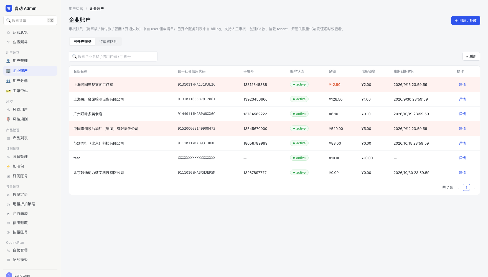

---

## 4. 页面二：企业详情（抽屉 → 平铺，本期核心）

### 4.1 页面结构

- 面包屑：`用户运营 / 企业账户 / 企业详情`
- 左上：**← 返回列表**（保留列表原筛选与分页状态）
- 头部卡片：企业名称 + 账户状态徽标 + USCC（等宽字体）；右侧操作按钮：**充值 / 发券 / 配置信用额度 / 配置专属折扣 / 挂载 tenant**（原「调整余额」入口下移至企业账单行内，改名「账单调整」）
- Sheet 切换（下划线 Tab）：**账户信息 | 认证信息 | 企业账单**，默认选中「账户信息」

> 「充值」「配置专属折扣」**沿用列表页现有弹窗**，不做新弹窗。

UI 稿（充值弹窗，沿用现有样式）：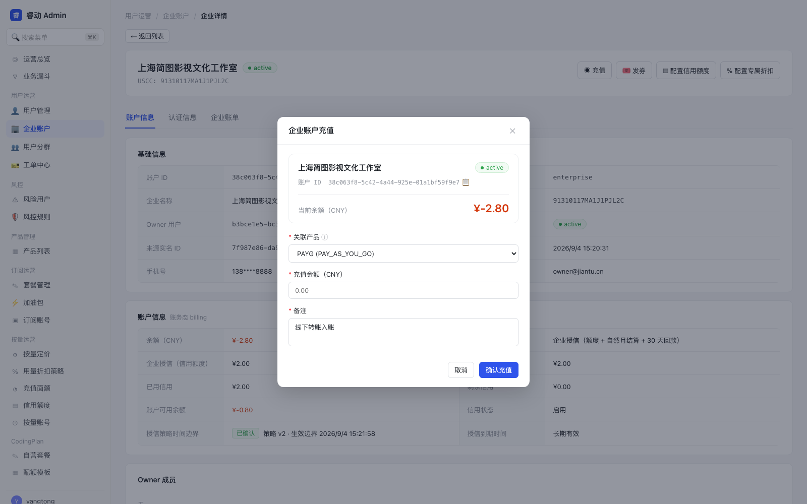

#### 4.1.1 发券弹窗

- 触发：点击头部卡片【🎟 发券】。
- 弹窗标题「发放代金券」，右上角 ✕ 关闭，背景遮罩。

| 字段    | 组件           | 规则                                         |
| ----- | ------------ | ------------------------------------------ |
| 企业名称  | 只读文本         | 自动带出当前企业                                   |
| 产品    | 下拉选择         | 如「全部产品 / 大模型 API / CodingPlan」，选项以产品列表接口为准 |
| 当前余额  | 只读文本         | 自动带出，负值标红                                  |
| 代金券金额 | 输入框（**必填**）  | 数字，**精确到分**，必须 > 0，单位 CNY                  |
| 发放原因  | 多行文本（**必填**） | **限 100 字符**，带字数统计（n/100）                  |
| 过期时间  | 日期组件         | **默认当前日期 + 31 天**，可修改，不可早于当前日期             |

- 底部按钮：**取消** / **确认**。
- 校验：代金券金额、发放原因为空时标红提示；通过后调用发券接口，成功 toast 并关闭弹窗，失败 toast 提示原因。

UI 稿：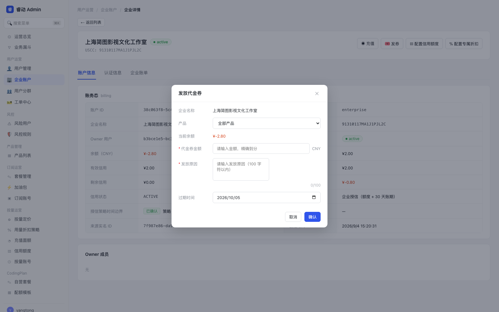

#### 4.1.2 配置信用额度弹窗

- 触发：点击头部卡片【▤ 配置信用额度】。
- 弹窗标题「配置信用额度」，右上角 ✕ 关闭，背景遮罩。

| 字段         | 组件           | 规则                                                                             |
| ---------- | ------------ | ------------------------------------------------------------------------------ |
| 企业名称       | 只读文本         | 自动带出当前企业                                                                       |
| 信用额度（CNY）  | 输入框（**必填**）  | 数字，**精确到分**，≥ 0                                                                |
| 状态         | 下拉选择         | **默认「停用」**，可选「启用」                                                              |
| **回款天数**   | 输入框（**必填**）  | **正整数**，**默认 30**，单位「天」。用于计算每张账单的回款死线 = **该账单月月末 + 回款天数**（原字段名「账期天数」易误读为倒计时，改名） |
| **授信到期时间** | 时间组件（**可选**） | 授信额度的有效期，精确到分钟；不填表示长期有效。与「账期截止时间」是两个概念，后者是每张账单的回款死线，不在此处配置                      |
| 变更原因       | 多行文本（**必填**） | **最大 100 字符**，带字数统计（n/100）                                                     |

- 底部按钮：**取消** / **确认**。
- 校验：信用额度、回款天数、变更原因为空或格式不合法时标红提示；通过后调用配置接口，成功 toast 并关闭弹窗、刷新账务态字段，失败 toast 提示原因。

**两条实现约束**

1. **额度重配不重置账期**：修改信用额度只影响额度大小，**不重新计算任何账单的回款死线**。
2. **走 UPDATE，不允许 delete + insert**：必须原地更新同一条记录，否则授信策略时间边界、变更历史与账单关联会断裂。变更留痕由 `billing_account_credit_events` 类事件表承担。

UI 稿：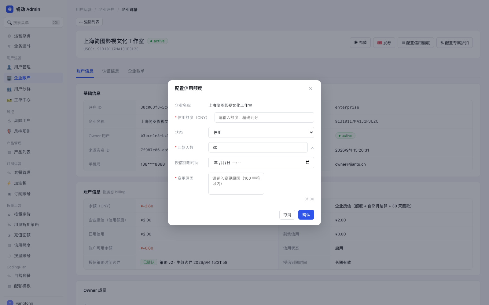

### 4.2 Sheet 1：账户信息

分三个区块，自上而下：**基础信息 → 账户信息（账务态 billing）→ Owner 成员**，均为双列描述网格。

**区块 1：基础信息**

| 字段       | 展示规则                |
| -------- | ------------------- |
| 账户 ID    | 等宽字体                |
| 类型       | 如 `enterprise`      |
| 企业名称     | —                   |
| USCC     | 等宽字体                |
| Owner 用户 | userId，等宽字体         |
| 账户状态     | 徽标（active=绿）        |
| 来源实名 ID  | 等宽字体                |
| 创建时间     | `YYYY/M/D HH:mm:ss` |
| 手机号      | 明文展示，不脱敏            |
| 邮箱       | 有则正常显示，无数据展示「—」     |

**区块 2：账户信息（账务态 billing）**

| 字段         | 展示规则                         |
| ---------- | ---------------------------- |
| 余额（CNY）    | 金额格式，精确到分，**负值标红**           |
| 资金处理方式     | 如「企业授信（额度 + 自然月结算 + 30 天回款）」 |
| 企业授信（信用额度） | 金额格式，精确到分（¥0.00）             |
| 有效信用       | 金额格式，精确到分                    |
| 已用信用       | 金额格式，精确到分                    |
| 剩余信用       | 金额格式，精确到分                    |
| 账户可用余额     | 金额格式，精确到分，**负值标红**           |
| 信用状态       | 启用 / 停用 / 已失效（逾期）            |
| 授信策略时间边界   | 状态标签（已确认）+ 策略版本 + 生效边界时间     |
| **授信到期时间** | 授信额度有效期；不填/无则展示「**长期有效**」    |

**字段计算口径**

| 字段       | 计算口径                              |
| -------- | --------------------------------- |
| 余额（CNY）  | 滚动充值 − 滚动消耗                       |
| 企业授信     | 即「配置信用额度」中设置的授信额度                 |
| **已用信用** | **当期未出账消耗 + Σ 未核销账单金额**（见 §6.2）   |
| 剩余信用     | 企业授信 − 已用信用                       |
| 信用状态     | 启用 / 停用由「配置信用额度」控制；已失效（逾期）由系统自动判定 |
| 授信到期时间   | 「配置信用额度」中设置；为空表示长期有效              |

**区块 3：Owner 成员**：展示 Owner 成员列表；无成员时展示「无」。

UI 稿：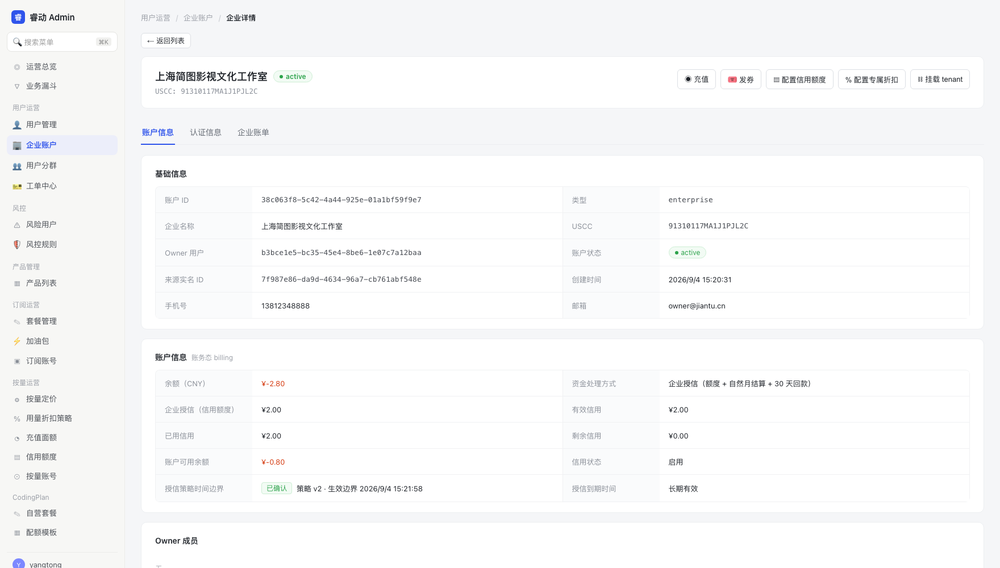

### 4.3 Sheet 2：认证信息

区块「认证态（user）」，双列描述网格，只读展示：

| 字段       | 说明                  |
| -------- | ------------------- |
| 认证状态     | 已认证 / 未认证 / 审核中（标签） |
| 认证类型     | 如「企业实名认证」           |
| 企业名称     | 认证主体名称              |
| 统一社会信用代码 | 等宽字体                |
| 法定代表人    | 无数据展示「—」            |
| 认证渠道     | 无数据展示「—」            |
| 实名 ID    | 等宽字体                |
| 认证时间     | 无数据展示「—」            |

> 字段以后端认证态接口为准，无数据的字段统一展示「—」。

UI 稿：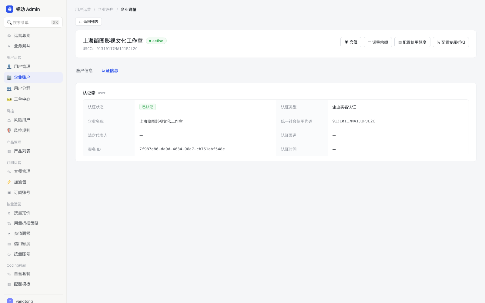

### 4.4 Sheet 3：企业账单（新增）

#### 4.4.1 账单生成规则（账单核算时间按照北京时间）

- 按**自然月**生成，每月一条，按月份**倒序**排列。
- **开始日期**：**`max(当月 1 日 00:00:00, 开户日)`**
- **结束日期**：当月最后一天 `23:59:59`（按大小月/闰年取正确月末日）。
- **账期截止时间（回款死线）**：`该月结束日期 + 回款天数`（默认 30 天）。
- **当月行实时累计**消耗（页面刷新即更新）。当月行**不加特殊标签**，与普通月份行样式一致；数据未定格仅通过下载账单时的 Excel 标注体现。
- 列表带分页（样式与账户列表一致）。

#### 4.4.2 列表列定义

| 列            | 说明                                          | 格式                 |
| ------------ | ------------------------------------------- | ------------------ |
| 企业名称         | 当前企业                                        | —                  |
| 账单月份         | `XXXX年X月`                                       | 如 2026年9月          |
| token 总量     | 当月消耗 token 汇总                               | 千分位整数              |
| 消耗总金额        | billing 原始消耗，**不可变**，精确到分                   | ¥0.00              |
| **已调整金额**    | Σ 该月调整记录的 signed 金额；**调减为负值，标红**            | ¥0.00 / **−¥0.00** |
| **应收金额**     | **= 消耗总金额 + 已调整金额**，客户实际应付                  | ¥0.00              |
| 核销金额         | 当月已核销金额，精确到分                                | ¥0.00              |
| 未核销金额        | **= 应收金额 − 核销金额**；**≤ 0 时标红**              | ¥0.00              |
| 剩余账期         | 从次月第一天开始计算；（小于10天企业列表该企业整行标红）               | 2000/00/00         |
| 状态           | 已核销（当月有过回款，不论金额大小）/ 待核销                     | 已核销 / 待核销          |
| **账期截止时间**   | 回款死线；已延期的显示**延期后日期**并加「已延期」标签（hover 显示原始死线） | 等宽字体               |
| 操作           | **核销、账单调整、延期、下载账单**                         | 描边小按钮              |

> 列表偏宽：**表格容器横向滚动（出现横向滚动条），所有单元格单行展示、不折行**（`white-space: nowrap`）；操作列固定在可视区右侧。
>
> 操作记录单独放到一个报表里 —— 二期功能。

UI 稿：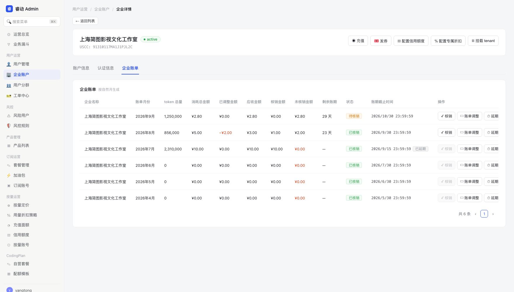

#### 4.4.3 账单调整（原「调整余额」）（UI稿需按高亮处调整）

- 触发：点击行内【▭ 账单调整】。该动作不改余额、不改原始消耗，调的是**该期应收金额**，模型见 §7。
- 弹窗标题「账单调整」，右上角 ✕ 关闭，背景遮罩。

| 字段        | 组件             | 规则                                                                   |
| --------- | -------------- | -------------------------------------------------------------------- |
| 企业名称      | 只读             | 自动带出                                                                 |
| **账单月份**   | 只读             | 自动带出该行账单月，如 `2026年8月`                                                |
| 消耗总金额     | 只读             | 原始消耗，本次调整不改变它                                                        |
| 已调整金额     | 只读             | 该月历史累计                                                               |
| 应收金额      | 只读             | = 消耗 + 已调整                                                           |
| 未核销金额     | 只读             | **标红强调**                                                             |
| **调整方向**  | 单选：**调增 / 调减** | **必选**                                                               |
| 调整金额      | 输入框（**必填**）    | 数字 **> 0**，**永远填正数**，精确到分；后端存 signed 值                               |
| 调整原因      | 多行文本（**必填**）   | 限 100 字，带字数统计（n/100）                                                 |
| **调整后预览** | 只读实时计算         | 显示「应收金额 X → Y，未核销 A → B」                                             |

**校验规则**

1. **方向显式化**：不允许在金额框填负数；方向由单选决定，金额恒为正。
2. **调减上限**：`调减金额 ≤ 消耗总金额 + 已调整金额`（调减后应收不得为负）。超限时输入框标红提示「调减后应收金额不可为负」。
3. **未核销可被压到 0 或负数**：如已核销 100 后调减 80，未核销变为 −80，**允许**，负值标红。
4. 确认后调用调整接口，成功后关闭弹窗并刷新账单列表，失败 toast 提示原因。
5. **调整记录不可编辑、不可删除**：写错需反向再记一笔冲销，两笔都留痕。

- 底部按钮：**取消** / **确认**。

UI 稿：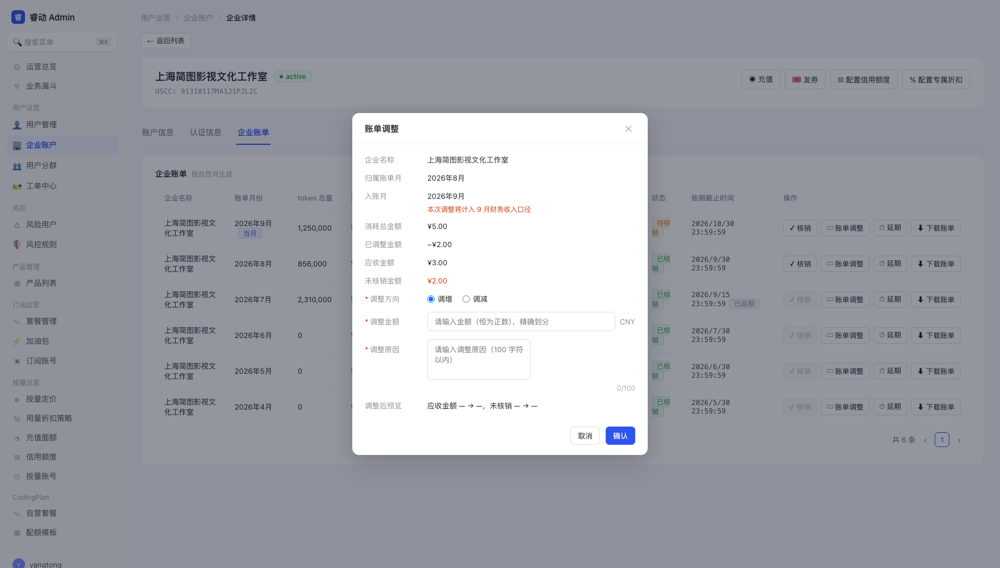

#### 4.4.4 账单调整与延期的分工

| 能力       | 平的是什么                     | 改的字段         |
| -------- | ------------------------- | ------------ |
| **账单调整** | **金额差异**（平台计费金额 ≠ 客户确认金额） | 已调整金额 → 应收金额 |
| **延期**   | **时间差异**（回款超期但业务不能停）      | 账期截止时间       |

职责独立，**行内按钮分开**，不合并成一个弹窗。

#### 4.4.5 核销弹窗（加一个备注，不为必填，可记录核销差异）

- 触发：点击行内【✓ 核销】。
- 弹窗标题「账单核销」，右上角 ✕ 关闭，背景遮罩。
- 弹窗内**只读带出该行数据**：企业名称、账单月份、消耗总金额、**已调整金额、应收金额**、未核销金额（标红强调）。
- 输入项：**本次核销金额**（单位 CNY，**精确到分**）。
- 底部按钮：**取消** / **确认**。

**校验规则**

1. 本次核销金额必填，必须为数字，**精确到分**。
2. 金额必须 **> 0**。
3. 金额必须 **≤ 未核销金额**；超限输入框标红并提示「不能超过未核销金额」。
4. 确认后调用核销接口；成功后关闭弹窗并刷新账单列表（核销金额增加、未核销金额减少），失败 toast 提示原因。
5. 核销成功后若该账单未核销 ≤ 0 且此前为逾期态 → 触发授信自动恢复（见 §6.3）。**部分核销（核销后未核销 > 0）不清账、不触发恢复，但该账单视为已有回款动作，不再参与自动失效判定。**

**未核销金额为 0 时的按钮处理：置灰**

- **未核销金额 ≤ 0 时【核销】按钮置灰**（含负值，不只是等于 0），未核销为负时红色展示。
- 置灰时 tooltip 显示「**无可核销金额**」；与权限置灰的「**无操作权限**」是两种原因，文案**必须区分**，不得共用。
- 置灰状态由未核销金额**实时决定**，不留快照；后续调整使未核销重新变正时按钮自动恢复可用。

UI 稿：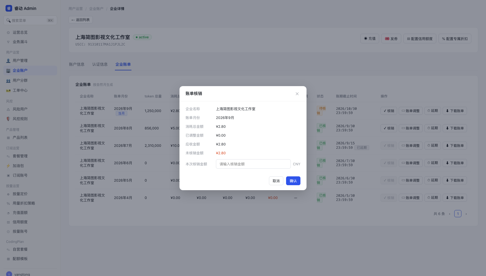

#### 4.4.6 延期（新增）

- 触发：点击行内【⏱ 延期】。
- 粒度：**单期账单**。只改该期回款死线，**不动授信额度**，不影响其他账期的生成与各自死线。
- 场景：客户因外部因素回款超 30 天但业务不能停；差异未决需要缓冲期。

| 字段           | 组件           | 规则                   |
| ------------ | ------------ | -------------------- |
| 企业名称         | 只读           | 自动带出                 |
| 账单月份         | 只读           | 自动带出                 |
| 未核销金额        | 只读           | 标红强调                 |
| 原回款截止日       | 只读           | 当前生效的死线              |
| **延期后回款截止日** | 日期组件（**必填**） | **必须晚于原截止日**；否则标红提示  |
| 延期原因         | 多行文本（**必填**） | 限 100 字，带字数统计（n/100） |

**规则**

1. **存储**：账单表需存 **延期后回款截止日**（为空则按默认「月末 + 回款天数」）。延期操作记录（操作人 / 时间 / 原截止日 / 新截止日 / 原因）—— 二期功能。
2. **自动失效判定逐账单**：按各账单**当前生效的死线**（延期后优先于默认）判断。
3. 延期可多次执行；列表「账期截止时间」列显示最新生效值 + 「已延期」标签。

UI 稿：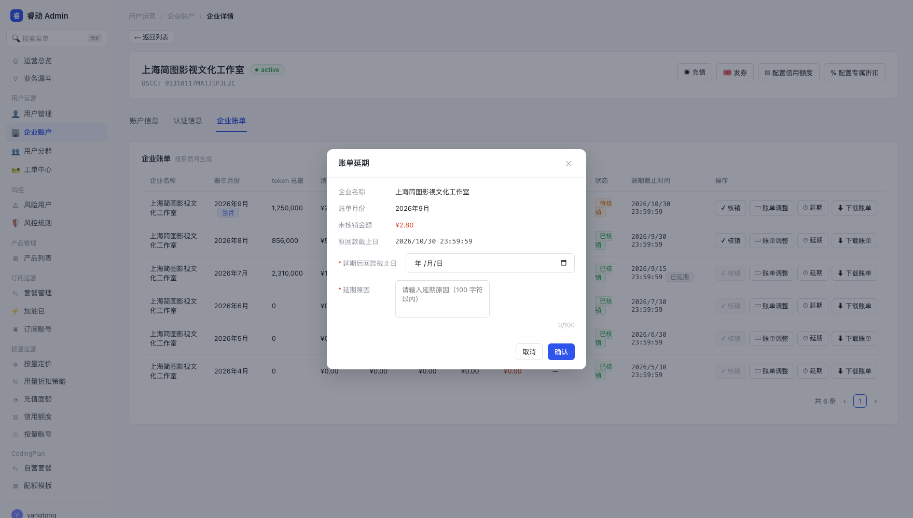

#### 4.4.7 下载账单

- 触发：点击行内【⬇ 下载账单】。弹出选择框：UTC 时间 / 北京时间。**无需进行选择，强制按照北京时间**。
- 行为：直接下载该月账单 **Excel 文件**（.xlsx），下载中按钮 loading，失败 toast 提示。
- 文件命名：`YYYY-MM- 企业名称-账单.xlsx`（如 `2026-09- 上海简图影视文化工作室-账单.xlsx`）。
- **文件模版**：见本文件夹 `2026-XX- XX公司-账单.xlsx`，共 3 个 sheet：

| Sheet  | 内容                                                                                                                |
| ------ | ----------------------------------------------------------------------------------------------------------------- |
| 账单汇总   | 标题「XX公司 —账单汇总」+ 账期；列：序号 / 账号ID / 用量(token) / 目录总价(¥) / 折后金额(¥) / 折扣 / 占比；底部：合计、已充值金额、金额调整、应收金额（= 合计折后 − 已充值 − 调整） |
| 产品模型汇总 | 按模型汇总：序号 / 模型 / 用量（Token）/ 目录总价(¥) / 折后金额(¥) / 折扣 / 占比；底部总计行                                                      |
| 账单明细   | 逐条用量明细：账期（自然日）/ 账户ID / 模型 / 类型（如缓存命中）/ 用量 / 目录价格 / 单价单位 / 折扣比 / 币种 / 目录价格 / 消耗金额                                  |

**当月账单下载**

- 当月**可下载**，Excel 内须显著标注「**数据截至 X 月 X 日 HH:mm，未定格**」。
- 标注位置：**三个 sheet 的标题行旁各加一处**。

**超出 Excel 行数上限时拆 sheet**

- 「账单明细」超出单表行数上限时**自动拆成多个 sheet**（`账单明细-1`、`账单明细-2` …）。
- 拆分原则：**尽可能不拆断整天的数据**——按自然日边界切分。
- 「账单汇总」「产品模型汇总」始终为单 sheet，合计口径覆盖全部明细。

UI 稿：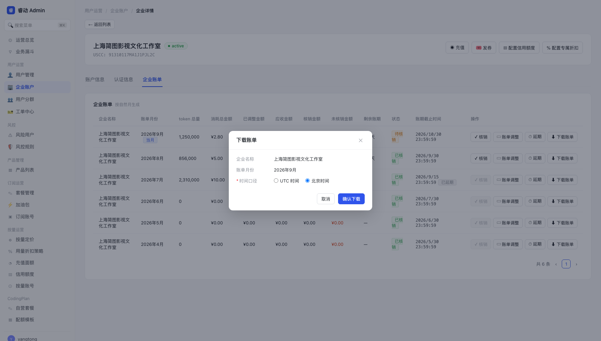

---

## 5. 通用交互与异常态

| 场景                                | 表现                                                               |
| --------------------------------- | ---------------------------------------------------------------- |
| 金额为负（余额、可用余额、**未核销金额**、**已调整金额**） | 红色字体                                                             |
| 字段无数据                             | 展示「—」                                                            |
| 授信到期时间为空                          | 展示「**长期有效**」                                                     |
| Owner 成员为空                        | 展示「无」                                                            |
| **操作按钮置灰 · 无可核销金额**               | 按钮置灰 + tooltip「**无可核销金额**」                                       |
| **操作按钮置灰 · 无操作权限**                | 按钮置灰 + tooltip「**无操作权限**」（**文案必须与上一条区分**）                        |
| **当月账单行**                         | 不加「当月」标签，与普通行样式一致；月中导出账单不出当日数据，截止前一天 23:59:59，Excel 内标注「数据截至 X 月 X 日 HH:mm，未定格」 |
| 接口失败                              | toast 提示，页面保留可操作                                                 |
| 返回列表                              | 保留列表页 Tab、搜索词、分页状态                                               |

---

## 6. 授信生命周期与账期

### 6.1 账期模型：自然月结算 + Net-30 回款

```
9/1 ──────────────── 9/30 ──────── 10/月初 ──────── 10/30
│   自然月消耗期       │ 月末出账     │ 核对/客户确认   │ 回款截止
│                     │（账单生成）   │ 付款           │ = 月末 + 30 天
```

| 概念           | 定义                                     | 粒度         | 存储位置        |
| ------------ | -------------------------------------- | ---------- | ----------- |
| 消耗期          | **自然月**（与账单「按自然月生成」对齐）                 | 每张账单       | 账单表：开始/结束日期 |
| **账期截止时间**   | 该月账单的**回款死线** = **该月月末 + 回款天数**（默认 30） | **每张账单一个** | 账单表         |
| **延期后回款截止日** | 人工延长后的死线；为空则取上式默认值                     | 每张账单一个     | 账单表         |
| **授信到期时间**   | 整个授信额度的**有效期**（配置弹窗可选，不填 = 长期有效）       | **每个账户一个** | 授信配置表       |

> **废弃旧口径**「账期截止时间 = 设置当日 + 账期天数」。

### 6.2 已用信用口径

```
已用信用 = 当期未出账消耗 + Σ 未核销账单金额
        = 当期未出账消耗 + Σ (消耗总金额 + 已调整金额 − 核销金额)
剩余信用 = 企业授信 − 已用信用
```

必须含**往月已出账未回款**部分，只算当期会漏算历史欠款导致授信被超用。

一笔 −2w 的调减使该账单未核销减少 2w → **已用信用自动减少 2w、剩余信用自动释放 2w**，无需 billing 为调整单独做信用额度回滚。

### 6.3 提醒 → 失效 → 恢复（二期功能）

**① 到期前提醒**

| 期次   | 范围                                    |
| ---- | ------------------------------------- |
| 二期   | **仅内部提醒**：运营工单 / Admin 站内通知           |
| 二期之后 | 再上线**对客提醒**（短信 / 邮件至企业 Owner）         |

**② 到期自动失效**

- **任一账单超其当前生效死线且从未发生核销**（核销金额 = 0，状态为「待核销」）→ **授信自动失效**，信用状态置为「已失效（逾期）」。
- **部分回款不失效**：账单发生过核销但仍有剩余未核销金额（状态「已核销」）→ **不触发自动失效**。剩余金额由运营通过「剩余账期」列、列表整行标红、延期等机制跟进清账；长期不清的升级处理并入二期提醒机制设计。
- 失效期间新消耗不可再占用信用额度（拦截行为以 billing 实现为准）。

**③ 核销后自动恢复**

- 逾期账单**核销清账**（未核销 ≤ 0）→ **授信自动恢复**。
- **恢复触发条件是「核销清账」，不是「充值」**：不允许"用新钱滚动欠旧账"。
- 存在多张逾期账单时，需**全部**清账后才恢复。

---

## 7. 账单调整模型

### 7.1 定义

**账单调整 = 修正某期账单的「应收金额」**，用于平掉**平台计费金额**与**客户实际确认金额**之间的差异（如折扣生效日晚于配置日、token 计数差异）。

### 7.2 四层数据模型

| 层       | 字段           | 可变性                   | 含义                                            |
| ------- | ------------ | --------------------- | --------------------------------------------- |
| **计费层** | 消耗总金额        | **不可变**               | billing 原始金额；与 Excel「账单明细」sheet 逐条加总**恒等** |
| **调整层** | 已调整金额        | **只增不改不删**（冲销需反向再记一笔） | Σ 调整记录的 signed 金额                             |
| **应收层** | 应收金额         | 派生                    | **= 消耗总金额 + 已调整金额**                           |
| **回款层** | 核销金额 / 未核销金额 | 核销只增                  | **未核销 = 应收金额 − 核销金额**                         |

```
8 月：平台计费 10w，客户核算后确认 8w，差异 2w（折扣配置晚了）
① 账单调整（8 月账单）：方向=调减，金额=20,000
   → 消耗总金额 100,000（不变）
   → 已调整金额 −20,000
   → 应收金额    80,000
② 核销 80,000
   → 核销金额    80,000
   → 未核销金额  0        ✅ 账单关闭
```

### 7.3 适用范围（待确认）

| 账户类型           | 账单生成       | 核销 / 账单调整 / 延期             |
| -------------- | ---------- | -------------------------- |
| **后付费 - 企业授信** | ✅          | ✅ 完整适用                     |
| **预付款**        | ✅（用于对账与下载） | **建议不适用**（钱已在充值时预收，无应收可核销） |

预付款账户的这三个按钮**置灰**，tooltip「预付款账户无需核销」。多收需退回走头部「**充值**」/「**发券**」出口。

> 若财务侧要求预付款也走"预收转收入"的核销动作，则口径需调整。

### 7.4 边界情况

| 情况           | 处理                                     |
| ------------ | -------------------------------------- |
| **调整写错**     | 不可编辑、不可删除；**反向再记一笔冲销**，两笔均留痕           |
| **调减后应收为负**  | **禁止**（校验拦截，见 §4.4.3 规则 2）             |
| **调减后未核销为负** | **允许**，负值标红（如已核销 100 后调减 80 → 未核销 −80） |
