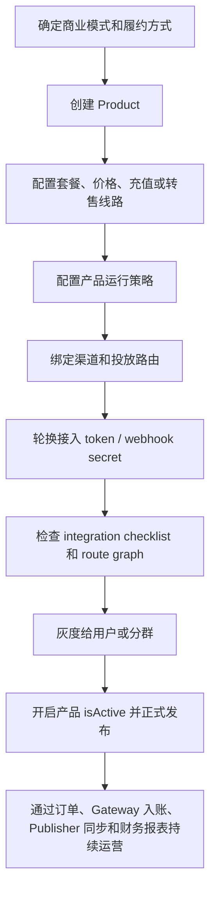

# codesphere-admin 新产品接入与管理业务逻辑

本文档基于 `origin/test` 分支截至 2026-07-14 的代码现状整理，说明一个新产品接入平台后，运营后台需要如何完成产品创建、计费配置、供给路由、上线校验和后续管理。

## 1. admin 在产品接入中的定位

`codesphere-admin` 是新产品接入的运营控制台和跨服务编排层，不是产品、计费或运行时数据的权威库。

- 产品、套餐、定价、订单、余额、渠道、路由、Publisher 同步等权威数据在 `codesphere-billing`。
- 用户、工作区、API Key 本地状态、实名认证和用户门户配置在 `codesphere-user`。
- admin 负责提供后台页面、权限控制、表单校验、运营流程入口和跨服务调用。
- admin-api 通过 `BillingInternalClient` 调用 `/api/internal/billing/admin/*`，通过 `UserInternalClient` 调用 `/api/internal/user/admin/*`，不能直连 user/billing 数据库。

主要代码入口：

- `apps/api/src/admin/admin.controller.ts`：产品、套餐、渠道、路由、订单、财务和用户管理 API。
- `apps/api/src/admin/admin.service.ts`：后台业务编排和 billing/user internal client 调用。
- `apps/admin/src/pages/Products/index.tsx`：产品创建、编辑、集成状态和 runtime policy 页面。
- `apps/admin/src/pages/DeliverySettings/index.tsx`：产品渠道、路由组、投放规则和 route graph 管理。
- `apps/admin/src/layouts/AdminLayout.tsx`：产品管理、订阅运营、按量运营、CodingPlan、供给与渠道等菜单入口。

## 2. 新产品接入的后台对象

一个产品上线通常会涉及以下对象：

| 对象 | 后台管理入口 | 权威服务 | 作用 |
| --- | --- | --- | --- |
| Product | 产品管理 | billing | 定义产品名称、slug、计费模式、启停、默认套餐和集成凭证 |
| Plan / PlanPrice | 套餐管理、CodingPlan 自营/三方套餐 | billing | 定义套餐权益、价格、周期、多币种价格 |
| RechargeTier | 充值面额 | billing | 定义 PAYG 产品的充值金额、赠送策略、上下架时间 |
| PaygModelPricingPolicy | 按量定价 | billing | 定义 PAYG 产品按模型计费的售价策略 |
| ModelAccess / ModelRoutePolicy | 模型库、套餐详情 | billing | 定义套餐可用模型和套餐级路由策略 |
| ProductRuntimePolicy | 产品管理中的运行策略 | billing | 定义凭证来源、模型范围、fallback、计费口径和协议策略 |
| Channel | 供应商管理/渠道管理 | billing | 定义上游供应商通道、模型、协议、限流和健康数据 |
| ProductChannel | 投放设置 | billing | 将某个 Channel 绑定到某个 Product |
| ProductChannelGroup | 投放设置 | billing | 将多个 ProductChannel 组成默认组、灰度组或故障转移组 |
| RouteAssignment | 投放设置 | billing | 按用户、用户分群、模型模式和客户端兼容性指向组或渠道 |
| ProviderLine / ResaleRoute | CodingPlan 转售配置 | billing | 定义转售供应商线路、上游产品和套餐到上游的履约路由 |

## 3. 接入前决策

新产品接入前必须先确定产品商业模式。后台产品表单支持三类 `billingMode`：

- `SUBSCRIPTION`：订阅套餐产品。典型流程是用户购买套餐，按周期获得积分、模型访问和订阅权益。
- `PAY_AS_YOU_GO`：按量计费产品。典型流程是用户充值余额，API Key 调用模型后按模型价格扣费。
- `CODING_PLAN`：CodingPlan 产品。再按 `codingPlanFulfillmentMode` 区分：
  - `platform_model_package`：平台自营模型套餐，套餐权益由本地模型访问和配额模板定义。
  - `provider_resale`：供应商转售套餐，用户购买后由供应商线路履约，上游权益来自同步的供应商产品。

后台接入流程必须围绕这个模式展开，因为不同模式的必填项和验收条件不同。

## 4. 标准接入流程

### 4.1 创建产品

入口：`产品管理 -> 新建产品`，对应 admin-api `POST /api/admin/products`。

必须填写：

- `name`：产品展示名称。
- `slug`：产品集成和前端解析使用的稳定标识，在 billing 中唯一。
- `billingMode`：`SUBSCRIPTION`、`PAY_AS_YOU_GO` 或 `CODING_PLAN`。

可选填写：

- `description`、`icon`、`sortOrder`：用于后台和用户侧展示。
- `webhookUrl`：产品后端接收 billing 配置同步的地址。
- `defaultPlanId`：订阅类默认套餐。admin 前端仅在 `SUBSCRIPTION` 模式下展示默认套餐选择。
- `codingPlanFulfillmentMode`：仅 `CODING_PLAN` 需要，非 CodingPlan 产品不应填写。
- `isActive`：是否进入可用产品集合。建议配置完整前先保持关闭。

admin-api 只做基础枚举校验，真实创建由 billing 执行。

### 4.2 配置产品集成凭证

入口：产品列表的接入状态/集成配置。

后台可执行：

- 查看接入状态：`GET /api/admin/products/:id/integration`。
- 配置产品级支付回跳策略：`PUT /api/admin/products/:id`，字段为 `allowedPaymentCallbackOrigins`。
- 轮换产品接入令牌：`POST /api/admin/products/:id/integration-token/rotate`。
- 轮换产品 webhook secret：`POST /api/admin/products/:id/webhook-secret/rotate`。

业务规则：

- integration token 和 webhook secret 只在轮换时返回明文，后台和 billing 后续只保存 hash、prefix、密文或轮换时间。
- 产品后端使用 integration token 访问 product portal / sync / SaaS provision 相关接口。
- billing 用 webhook secret 对产品配置同步 webhook 签名。
- 外部产品通过 `POST /partner/v1/payment/create` 创建支付订单时，billing 根据 integration token 识别产品，并按该产品的策略校验 `successUrl` / `cancelUrl`。
- 产品集成页会展示 checklist，运营应在上线前确认计划、默认计划、支付回跳白名单、webhook、token、secret、虚拟 key 和 PAYG 默认绑定等状态。只有非空的产品白名单会将支付回跳标记为已就绪；继承全局配置仅用于兼容，空数组表示明确禁用。

支付回跳策略支持三种状态：

| 后台策略 | 存储值 | 生效规则 |
| --- | --- | --- |
| 继承全局配置 | `null` | 使用 billing 全局回跳白名单，仅用于兼容历史或内部产品 |
| 禁止全部回跳 | `[]` | 拒绝该产品的所有 `successUrl` / `cancelUrl` |
| 产品白名单 | 非空字符串数组 | 只允许该产品配置的 Origin，不与全局白名单合并 |

白名单项必须是纯 HTTP/HTTPS Origin，即只包含协议、域名和可选端口。不能包含业务路径、查询参数、锚点、用户名密码或通配符；生产域名必须使用 HTTPS，HTTP 仅允许 `localhost`、`127.0.0.1` 和 `[::1]`。单个产品最多配置 50 项，保存时会规范化并去重。例如，配置 `https://app.example.com` 后，可以回跳到 `https://app.example.com/billing/success?orderId=...`，但不能回跳到不同协议、子域或端口。

`successUrl` / `cancelUrl` 与 Webhook 必须分开理解：前者是支付页在用户浏览器中返回产品页面的地址，后者是 Billing 服务端向产品后端发送事件通知的地址。配置支付回跳白名单不会修改 Webhook 地址、签名或投递行为。

产品接入页同时展示当前策略来源和有效 Origin。管理员保存后，下一次 Partner OpenAPI 请求立即使用新配置，不需要修改 billing 环境变量或重启服务。新增外部产品应优先使用产品白名单，不应依赖全局配置。

### 4.3 配置套餐和价格

不同模式的后台入口不同。

`SUBSCRIPTION`：

- 在 `套餐管理` 创建或维护套餐。
- 通过 `PlanPrice` 配置多币种价格。
- 如产品需要注册后自动开通默认免费计划，应配置可用默认套餐。
- 如果产品由外部 SaaS 接入，需同时配置产品 webhook 和接入凭证。
- 外部 SaaS 产品通过 billing provision 接口自动开通用户/租户时，会走默认命名的虚拟 Key：billing 默认创建或复用名为 `saas:{productSlug}:virtual` 的 API Key，并把该 Key 同步到 Publisher/Gateway。
- 这不是所有订阅购买都会创建的 Key，也不是所有用户共享的一条全局 Key；每个实际开通仍按 `userId + tenantId + productId + key name` 落一条 API Key 记录。
- 产品集成页的 `hasActiveVirtualKey` 是按产品和默认 key 名称统计是否至少已有 active 虚拟 Key，表示 SaaS provision 链路已打通过，不代表每个用户/租户都已开通。
- 虚拟 Key 的资金判定不是 PAYG 钱包余额，而是订阅产品下的 active subscription period / credit transaction 积分池。
- 详细技术链路见 `codesphere-billing/docs/saas-provisioning-flow.zh-CN.md`。

`PAY_AS_YOU_GO`：

- 在 `按量定价` 配置 `PaygModelPricingPolicy`。
- 在 `充值面额` 配置 `RechargeTier`，包括充值金额、赠送类型、赠送值、上下架时间。
- 在 `供应商成本` 配置 provider cost，用于毛利、成本和财务分析。
- 确认该产品有可用 API Key 默认绑定，用户侧创建 API Key 时才能稳定绑定该 PAYG 产品。

`CODING_PLAN / platform_model_package`：

- 在 `CodingPlan -> 自营套餐` 创建自营套餐。
- 自营套餐必须绑定 CodingPlan 产品。
- 套餐上架前至少需要一个启用模型访问项。
- 套餐上架前必须绑定至少一个配额模板，且至少一个模板处于启用状态。
- 自营套餐的散字段 `rateLimitRpm`、`rateLimitTpm`、`maxContextWindow` 保存时归 0，执行和展示依赖配额模板。

`CODING_PLAN / provider_resale`：

- 在 `CodingPlan -> 转售配置` 创建或维护供应商线路。
- 同步供应商上游产品目录。
- 在 `CodingPlan -> 三方套餐` 创建转售套餐。
- 套餐详情只能从已同步上游产品目录选择 `providerLineId` + `upstreamProductId`，不应手填上游 productId。
- 转售套餐的履约规则由 `CodingPlanResaleRoute` 决定。

### 4.4 配置产品运行策略

入口：产品列表中的运行策略弹窗，对应：

- `GET /api/admin/products/:id/runtime-policy`
- `PUT /api/admin/products/:id/runtime-policy`

可配置项包括：

- `credentialSource`：`platform_pool` 或 `provider_entitlement`，决定运行时使用平台凭证池还是供应商权益凭证。
- `allowedProviderIds` / `allowedChannelIds`：限制产品可用 provider 或 channel。
- `modelScopeMode`：`plan_configured`、`product_allowlist` 或 `upstream_inherited`。
- `allowedModels`：产品级模型白名单。
- `fallbackPolicy`：`none`、`within_product`、`within_provider`、`platform_default`。
- `runtimeBillingMode`：`payg_balance`、`subscription_credits`、`token_plan_quota`、`included_upstream`。
- `routeStrategy`：`priority`、`weight`、`latency`、`least_busy`。
- `protocolStrategy`：`auto` 或 `passthrough_only`。
- 高损桥接开关、原因、负责人、过期时间和审批信息。
- `status`：策略启停。

保存 runtime policy 后，billing 会递增 policy revision，并同步运行时意图到 Publisher/Gateway。admin 只触发保存动作。

### 4.5 配置渠道和投放

入口：`供给与渠道 -> 投放设置`，对应产品下的渠道、渠道组、路由分配和 route graph。

可配置对象：

- `ProductChannel`：把全局 Channel 绑定到 Product，并设置产品内展示名、状态、默认标记、模型白/黑名单、优先级、权重、RPM/TPM。
- `ProductChannelGroup`：将产品渠道组织为路由组，策略支持 `weighted_failover`、`priority_failover`、`round_robin`、`cost_first`、`latency_first`。
- `ProductChannelGroupMember`：设置组内成员角色 `primary`、`fallback`、`shadow`，以及成员级优先级、权重、RPM/TPM。
- `RouteAssignment`：按 `USER` 或 `USER_SEGMENT` 分配到 `GROUP` 或 `PRODUCT_CHANNEL`，支持 `ONLY` / `PREFER`、模型模式、客户端兼容性、优先级、生效时间和失效时间。

投放设置向导支持：

- 选择产品。
- 选择已有 channel 并批量绑定。
- 创建路由组。
- 设置全量、人群分群或指定用户的投放目标。
- 保存后由 billing 生成/更新运行时 route graph。
- 预览 route graph 或手动重建。

### 4.6 配置用户运营和财务可见性

新产品上线后，后台需要能按产品维度管理和排障：

- `用户详情`：查看用户在各产品下的套餐、余额、API Key、订阅和交易聚合。
- `订阅账号`：按 `productId` 筛选订阅。
- `按量账号`：按 PAYG 产品查看余额、allowance 和 API Key。
- `Gateway 入账`：按 `productId`、`apiKeyId`、`requestId`、模型和状态筛选入账事件。
- `财务报表`：查看收入、交易、退款和产品相关财务明细。
- `Publisher 同步`：查看产品、渠道、模型、API Key、余额同步任务，可重试或 replay。

## 5. 不同产品模式的上线验收

### 5.1 订阅产品验收

- 产品已创建且 `billingMode=SUBSCRIPTION`。
- 至少有一个有效套餐。
- 如需要自动开通，`defaultPlanId` 指向同产品有效套餐。
- 如外部产品需要同步，已配置 `webhookUrl`、integration token 和 webhook secret。
- 如外部产品需要浏览器支付，已配置产品级支付回跳白名单，并用该产品 integration token 验证允许和拒绝场景。
- SaaS provision 场景下，已存在 active 虚拟 Key `saas:{productSlug}:virtual`，并且 Publisher/Gateway 的 KeyMeta/KeyBalance 已同步。
- 用户侧 `/billing/plans?productId=...` 能看到正确套餐。
- 支付链路能创建 `SUBSCRIPTION` 订单并完成订阅履约。
- 订阅、积分、交易和财务报表能按产品查询。

### 5.2 PAYG 产品验收

- 产品已创建且 `billingMode=PAY_AS_YOU_GO`。
- 至少配置一个有效充值面额。
- 至少配置核心模型的 PAYG 售价策略。
- 供应商成本策略已覆盖主要 provider/model。
- 用户侧能解析当前 PAYG 产品；如存在多个 PAYG 产品，需要配置前端产品 ID 或 slug。
- API Key 创建时能绑定该 PAYG 产品，并通过 provisioning outbox 激活。
- Gateway 入账按 `productId` 扣费，账务和 usage 报表可查询。

### 5.3 自营 CodingPlan 验收

- 产品已创建且 `billingMode=CODING_PLAN`，`codingPlanFulfillmentMode=platform_model_package`。
- 自营套餐绑定该产品。
- 上架套餐有启用模型访问项。
- 上架套餐绑定了启用中的配额模板。
- runtime policy 的 `runtimeBillingMode` 应符合 token plan quota 语义。
- 用户购买后能获得 CodingPlan entitlement。
- 用户能在套餐页创建 entitlement 专属 API Key。
- 专属 API Key 与 entitlement 绑定，配额由套餐共享池执行。

### 5.4 转售 CodingPlan 验收

- 产品已创建且 `billingMode=CODING_PLAN`，`codingPlanFulfillmentMode=provider_resale`。
- 至少一条供应商线路已配置、测试通过并同步上游产品。
- 三方套餐绑定该产品。
- 每个售卖套餐有有效 `CodingPlanResaleRoute`，指向 provider line 和 upstream product。
- 用户重复购买同一有效转售套餐会被 user/payment 代理阻断。
- 付款成功后能创建供应商权益，失败可在后台重试。
- 用户可查看已购转售套餐、上游 key 和使用趋势。

## 6. 上线后的管理动作

| 场景 | 后台动作 | 注意事项 |
| --- | --- | --- |
| 产品临时下线 | 产品管理中关闭 `isActive` | 不等于删除历史订单、订阅和用量 |
| 调整套餐价格 | 套餐详情/PlanPrice 修改 | 注意已有订阅、促销和发票口径 |
| 增加模型 | 模型库、模型访问、产品渠道 allowedModels | 需要同步到运行时并观察 route graph |
| 调整流量 | 投放设置修改组、权重、优先级或 route assignment | 保存后检查 Publisher 同步状态 |
| 替换供应商 | 先新增 channel，再灰度分群路由，最后切默认组 | 避免直接删除仍被路由引用的 channel |
| 轮换凭证 | 产品集成 token、webhook secret、渠道 API Key 分别轮换 | 明文只展示一次，需同步给对应接入方 |
| 排查扣费 | Gateway 入账按 requestId/productId 查询并重试 | 真实账务动作在 billing |
| 排查运行时 | Publisher 同步任务、route graph 预览/重建 | admin 只触发受控重推 |

## 7. 权限与边界要求

- 产品和套餐查看需要 `admin.plans.view`。
- 产品、支付回跳策略、接入凭证和 runtime policy 管理需要 `admin.page.products.manage`。
- 产品渠道、渠道组、路由分配和 route graph 管理需要 `admin.channels.manage` 或 `admin.channels.view`。
- 订单、退款和重试需要订单相关权限。
- Gateway 入账、交易和财务报表需要交易/收入相关权限。
- 所有跨服务管理动作必须携带管理员上下文，便于 billing/user 审计。

## 8. 推荐操作顺序

